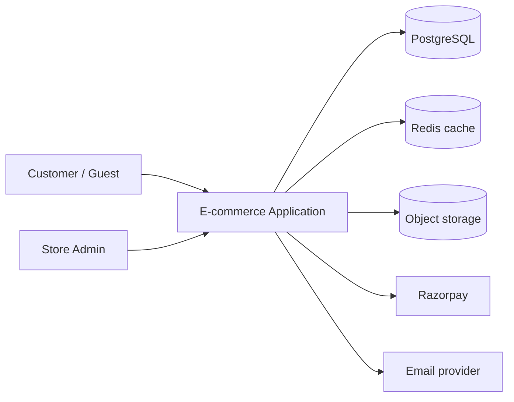
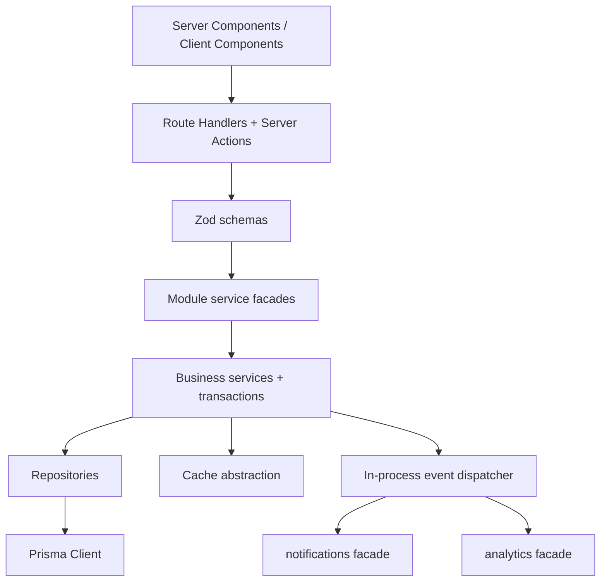
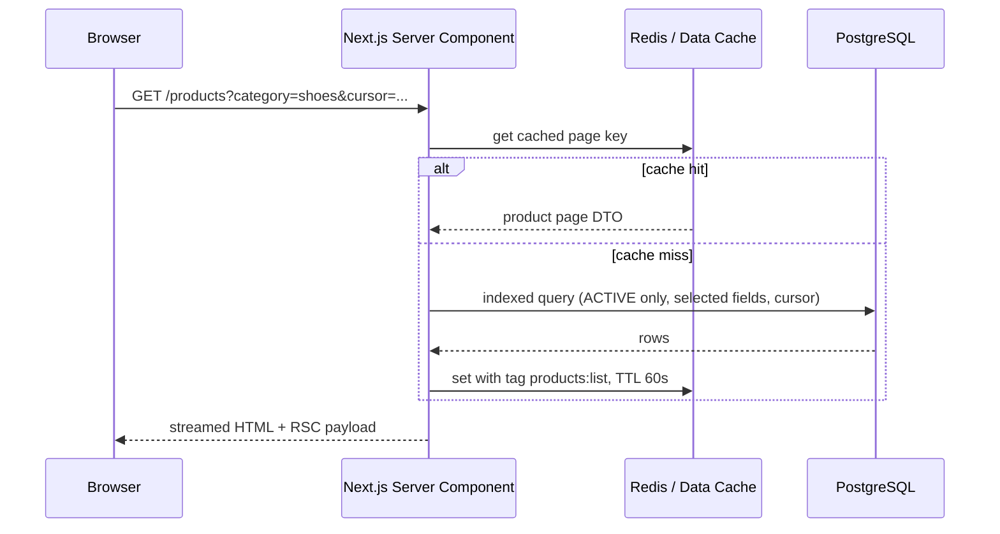
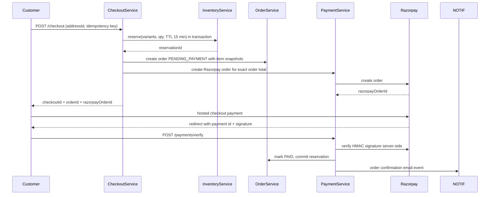
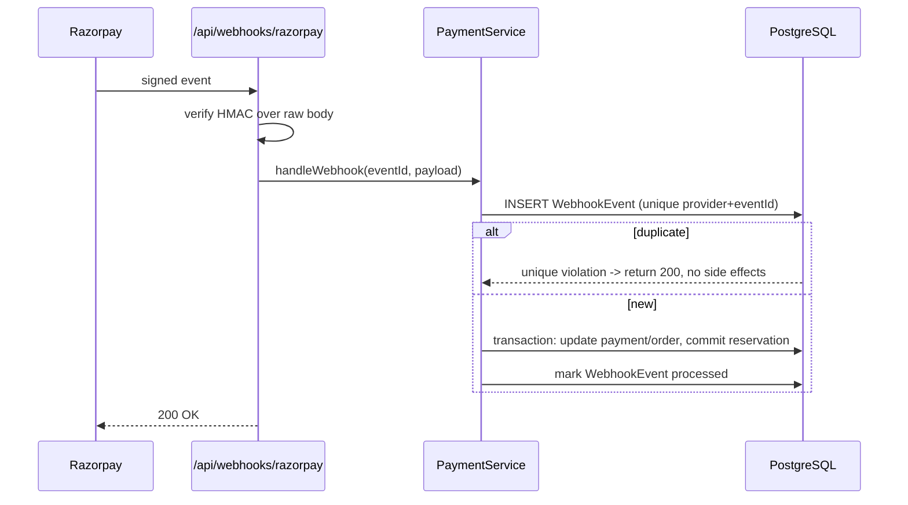

# System Architecture (Task 0.5)

## Drivers

The design is driven by the non-functional requirements in `docs/requirements.md`: maintainability with module extraction in mind, correct money and stock under concurrency, fast cached catalog reads, and stateless horizontal scaling.

## Context

## Container View

| Container | Technology | Responsibility | Scales by |
| --- | --- | --- | --- |
| Web/API application | Next.js App Router, Server Components, Route Handlers, Server Actions | Render UI, validate input, orchestrate services | More stateless instances behind load balancer |
| Primary database | PostgreSQL | System of record, transactions, constraints | Vertical first, read replicas later |
| Cache | Redis | Catalog fragments, rate-limit counters, reservation TTLs, idempotency guard | Cluster later |
| Object storage | S3-compatible | Product images | Provider-managed |
| Payment gateway | Razorpay hosted checkout + webhooks | Card processing, refunds | Provider-managed |
| Email provider | SMTP/API (selected in Task 3.5) | Transactional email | Provider-managed |

## Component View (inside the application)

**Why this shape:** route handlers stay thin (parse + validate + call service + map errors). Business rules are callable from both HTTP and Server Actions, so there is one implementation of each rule. Repositories are the only place with Prisma queries, enabling query optimization and test doubles.

## Request Lifecycle

1. Edge/CDN serves static assets and cached public pages.
2. Next.js resolves the route; middleware handles correlation ID, rate limit and coarse auth checks.
3. Route Handler/Server Action validates with Zod and builds an `ActorContext` (`userId`, `role`, `guestToken`).
4. Guard checks `resource:action`; service re-checks authorization.
5. Service uses repositories inside a transaction where multiple rows change.
6. Cache is read through with tags; mutations invalidate affected tags and call `revalidateTag`/`revalidatePath`.
7. Errors are mapped to the documented envelope with a request ID; unexpected errors go to the error tracker.

## Key Flows

### Public catalog read (read-optimized)

### Checkout with reservation and payment

### Webhook (idempotent)

## Cross-Cutting Concerns

| Concern | Approach |
| --- | --- |
| Validation | Zod schemas shared by route handlers, Server Actions and service boundaries; parse at the edge, trust typed values inside |
| Errors | Typed `AppError` hierarchy (Validation, Unauthorized, Forbidden, NotFound, Conflict, Payment); one error mapper for HTTP |
| Logging | Structured JSON logs, correlation ID from middleware, no secrets or raw card/payment payloads logged |
| Transactions | Prisma `$transaction` for stock, order and payment state changes; no network calls inside DB transactions where avoidable |
| Idempotency | `Idempotency-Key` header with `IdempotencyKey` row; webhook dedupe via `WebhookEvent` uniqueness |
| Caching | Public data cached with tags and TTLs; personalized/cart/checkout data never in shared cache |
| Authorization | Guards at route + service; ownership filters in repositories |
| Observability | Request metrics, error tracking, payment/webhook alerts (Phase 12) |
| Time & money | UTC timestamps; integer minor units for money; Razorpay receives the same integer |

## Architecture Decision Records

| ADR | Decision | Why | Revisit when |
| --- | --- | --- | --- |
| 001 | Modular monolith first, no microservices | One deployable, one transaction boundary; fastest path to a working store with clean extraction seams | Independent scaling/ownership need appears |
| 002 | Prisma + PostgreSQL | Type-safe repositories, migrations, transactions, strong constraints | Query patterns need a specialized store |
| 003 | Auth.js with database sessions | Secure cookies, server-controlled revocation, works across instances | Central identity provider becomes mandatory |
| 004 | Redis as cache, not source of truth | Speed without risking divergent data; all cached data reconstructible from Postgres | Cache hit rate or write patterns justify more |
| 005 | Razorpay hosted checkout | Keeps card data out of PCI scope and reduces compliance burden | Custom checkout UX is contractually required |
| 006 | Service facades between modules | Prevents repository leakage and enables later extraction | Never (rule remains) |
| 007 | Integer minor units for money | Removes floating-point drift and matches Razorpay's amount format | Multi-currency needs dynamic minor-unit rules |

## Deployment View

- One Next.js container image, multiple stateless replicas behind a reverse proxy/load balancer.
- PostgreSQL primary with connection pooling (`PgBouncer` or provider pooler); `DIRECT_URL` reserved for migrations.
- Redis shared by all replicas; no in-process session or cart state.
- Static assets and product images served via CDN.
- Blue/green or rolling deploys; migrations are backward-compatible (expand-then-contract).

## Architectural Risks

| Risk | Mitigation |
| --- | --- |
| Module boundaries erode over time | Facade-only imports; review checklist; no cross-module repository imports |
| Oversell under concurrency | Conditional stock update in transaction + reservation TTL |
| Duplicate payments/orders | Idempotency key + webhook dedupe + DB unique constraints |
| Cache serving stale prices | Prices re-read on checkout; cache tags invalidated on product/coupon update |
| Premature infrastructure | Each new component needs a task with a measured requirement |
| Migrations block rolling deploys | Backward-compatible migrations only, introduced in Task 2.6 |
