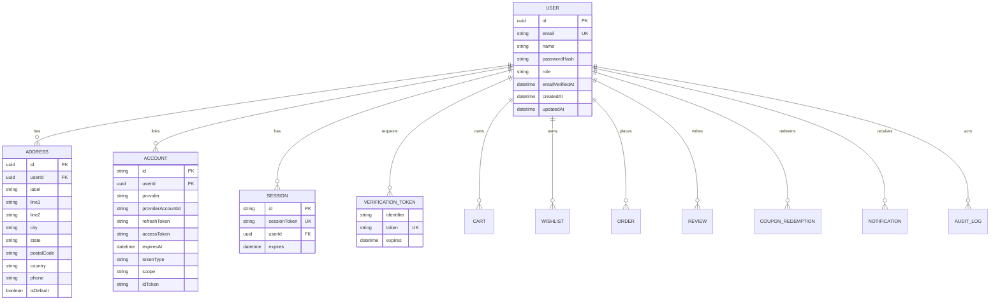
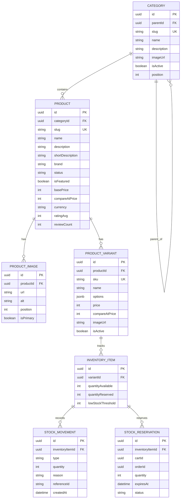
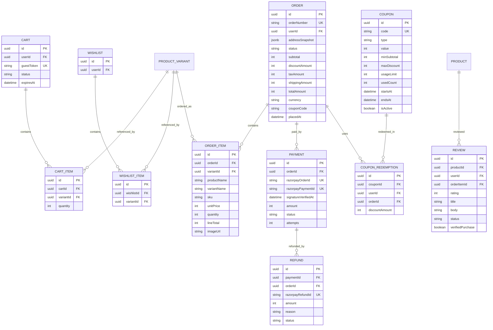
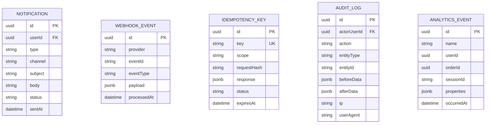

# Database ER Design (Task 0.6)

This is the logical design that Task 2.3 will translate into `prisma/schema.prisma`. Money is stored as **integer minor units** (paise); timestamps are UTC. IDs are UUIDs except where noted.

## Identity and Users

## Catalog and Inventory

`ratingAvg` is stored as an integer out of 100 (e.g. 4.5 -> 450) to avoid float drift; rendered as `ratingAvg / 100` at the UI edge.

## Commerce and Engagement

## Infrastructure Tables

## Constraints

| Table | Constraint | Reason |
| --- | --- | --- |
| `User` | `email` unique, case-insensitive normalized | One account per email |
| `Account` | unique `(provider, providerAccountId)` | One OAuth identity per provider |
| `VerificationToken` | unique `(identifier, token)`; expiry checked in service | Single-use tokens |
| `Category` | `parentId` self FK with cycle prevention in service | Tree integrity |
| `Product` / `ProductVariant` | unique `slug` / unique `sku` | Stable public URLs and fulfillment identity |
| `InventoryItem` | `quantityAvailable >= 0`, `quantityReserved >= 0` | No negative stock |
| `CartItem` | unique `(cartId, variantId)` | Quantity merged on repeat add |
| `WishlistItem` | unique `(wishlistId, variantId)` | No duplicate saved items |
| `User.address` | at most one `isDefault` per user (partial unique index) | Deterministic default address |
| `CouponRedemption` | unique `(couponId, orderId)` | Coupon used once per order |
| `Coupon` | `usageLimit >= usedCount` enforced in transaction | No over-redemption |
| `Order` | `orderNumber` unique | Human-facing identifier |
| `OrderItem` | snapshot columns immutable after creation | Historical price integrity |
| `Payment` | unique `razorpayOrderId`, unique non-null `razorpayPaymentId` | No duplicate gateway records |
| `Refund` | unique `razorpayRefundId` | Idempotent refunds |
| `Review` | unique `(productId, userId)`, `rating` 1–5 | One moderated review per user per product |
| `WebhookEvent` | unique `(provider, eventId)` | Webhook deduplication |
| `IdempotencyKey` | unique `key` within scope | Duplicate request protection |

## Indexes

| Table | Index | Supports |
| --- | --- | --- |
| `Product` | `(status, categoryId, createdAt DESC)` | Public listing by category |
| `Product` | `slug` (unique) | Detail page lookup |
| `Product` | `isFeatured, status` partial | Home page featured products |
| `ProductVariant` | `sku` (unique), `(productId, isActive)` | SKU lookup and detail variants |
| `Category` | `slug` (unique), `(parentId, position)` | Tree and URL lookup |
| `InventoryItem` | `(quantityAvailable)` where below threshold partial | Low-stock alerts |
| `Cart` | `(userId, status)`, `guestToken` (unique) | Fast cart lookup |
| `Wishlist` | `userId` (unique) | User wishlist |
| `Order` | `(userId, placedAt DESC)`, `(status, placedAt DESC)` | Order history and admin queue |
| `OrderItem` | `orderId` | Order detail |
| `Payment` | `razorpayOrderId` (unique), `orderId` | Verification and order lookup |
| `Coupon` | `code` (unique), `(isActive, endsAt)` | Validation queries |
| `Review` | `(productId, status)` | Approved review list |
| `Notification` | `(userId, createdAt DESC)` | Notification list |
| `WebhookEvent` | `(provider, eventId)` (unique) | Dedupe |
| `IdempotencyKey` | `key` (unique), `expiresAt` | Idempotency and cleanup |
| `StockReservation` | `(status, expiresAt)` | Expiry sweeper |
| `AnalyticsEvent` | `(name, occurredAt DESC)`, `(userId, occurredAt DESC)` | Reports |

## Deletion Policy

- Soft-delete via `status = ARCHIVED` for products/categories; hard delete only for expired carts, tokens and old idempotency keys.
- Foreign keys use `Restrict` for order/payment/review history and `Cascade` for dependent child rows such as cart items and images.
