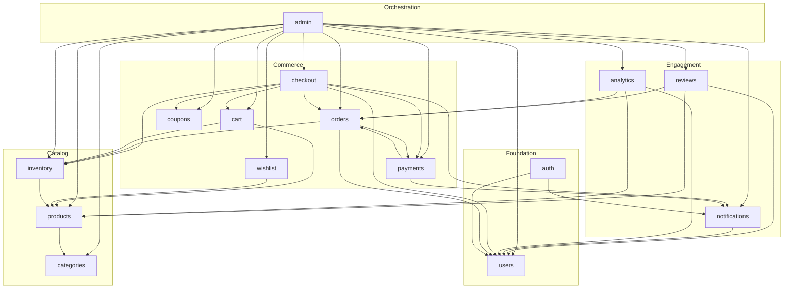

# Application Modules (Task 0.4)

The application is divided into 15 business modules. Each module owns its data, exposes a **service facade**, and hides its repositories and Prisma models from other modules.

## Dependency Rules

1. Dependencies point **downward only** (see layers below). No cycles, no upward imports.
2. A module never imports another module's repository, schema or Prisma model types. It imports the other module's facade and receives plain DTOs.
3. Cross-module writes run in one Prisma transaction coordinated by a service in the layer above, never by a route handler.
4. `admin` is an orchestration module: it calls other facades for data and mutations; other modules never import `admin`.
5. Side effects (email, analytics events) are dispatched through `notifications`/`analytics` facades; direct imports of mail or analytics SDKs from other modules are forbidden.

## Module Catalogue

### Foundation Layer

| Module | Responsibility | Owns | Public facade (planned) | Depends on | Future service |
| --- | --- | --- | --- | --- | --- |
| **auth** | Registration, credentials, sessions, verification/reset tokens, RBAC enforcement, route guards | `Account`, `Session`, `VerificationToken` | `AuthService.register/login/logout/verifyEmail/resetPassword/requirePermission` | users, notifications | Authentication Service (first candidate) |
| **users** | User profiles and addresses; role data for authorization context | `User`, `Address` | `UserService.getById/getActorContext/create/updateProfile/manageAddress` | — | part of Authentication/Identity Service |

### Catalog Layer

| Module | Responsibility | Owns | Public facade (planned) | Depends on | Future service |
| --- | --- | --- | --- | --- | --- |
| **categories** | Hierarchical category tree, slugs, ordering, active flags | `Category` | `CategoryService.create/update/list/getBySlug/reorder` | — | Catalog Service |
| **products** | Products, images, variants, public catalog projection, search index input | `Product`, `ProductImage`, `ProductVariant` | `ProductService.create/update/list/getBySlug/getVariant/getPublicById` | categories | Catalog Service |
| **inventory** | Stock levels, reservations, movements, oversell prevention | `InventoryItem`, `StockReservation`, `StockMovement` | `InventoryService.getAvailability/reserve/release/commit/adjust` | products | Inventory Service (owns its own DB) |

### Commerce Layer

| Module | Responsibility | Owns | Public facade (planned) | Depends on | Future service |
| --- | --- | --- | --- | --- | --- |
| **cart** | Guest/user carts, item mutation, server-side totals | `Cart`, `CartItem`, guest token | `CartService.getOrCreate/addItem/updateQuantity/removeItem/calculateTotals/mergeGuestCart` | products, inventory | Cart Service |
| **wishlist** | Saved variants per user | `Wishlist`, `WishlistItem` | `WishlistService.get/add/remove/list` | products | part of Catalog/User service |
| **coupons** | Coupon CRUD, validation, redemption recording | `Coupon`, `CouponRedemption` | `CouponService.create/update/validate/redeem` | — | Promotion Service |
| **checkout** | Orchestrates address, stock reservation, pricing, coupon, order and payment creation | no tables of its own | `CheckoutService.validate/prepare/createOrder` | cart, inventory, coupons, orders, payments, users, notifications | Checkout/Order orchestrator |
| **orders** | Order lifecycle, state machine, history, cancellation, refund coordination | `Order`, `OrderItem` | `OrderService.create/getForUser/getById/transition/cancel/requestRefund` | inventory, users, payments | Order Service |
| **payments** | Razorpay order creation, signature verification, webhook idempotency, refunds | `Payment`, `Refund`, `WebhookEvent`, `IdempotencyKey` | `PaymentService.createOrder/verifyCallback/handleWebhook/refund` | orders, notifications | Payment Service |

### Engagement Layer

| Module | Responsibility | Owns | Public facade (planned) | Depends on | Future service |
| --- | --- | --- | --- | --- | --- |
| **reviews** | Review submission, moderation, rating aggregation | `Review` | `ReviewService.create/moderate/listForProduct/getSummary` | products, users, orders | Review Service |
| **notifications** | Email/in-app notification dispatch and delivery log | `Notification` | `NotificationService.send/queue/retry/listForUser` | users | Notification Service |
| **analytics** | Event recording and dashboard/report queries | `AnalyticsEvent`, report projections | `AnalyticsService.track/getDashboard/getSalesReport` | orders, products, users | Search/Analytics pipeline |

### Orchestration Layer

| Module | Responsibility | Owns | Public facade (planned) | Depends on | Future service |
| --- | --- | --- | --- | --- | --- |
| **admin** | Admin-only use cases combining several modules; input for admin screens | no tables of its own | `AdminService.*` wrappers with permission checks | all modules below | API Gateway / BFF |

## Cross-Module Workflows

| Workflow | Coordinator | Steps |
| --- | --- | --- |
| User registration | auth | create user -> create empty cart -> send verification email |
| Guest cart merge | cart | load guest cart -> merge into user cart -> delete guest token |
| Checkout | checkout | validate cart -> reserve stock -> validate coupon -> compute totals -> create order -> create Razorpay order |
| Payment success | payments | verify signature -> mark payment captured -> confirm order -> commit reservation -> send email -> track analytics |
| Payment webhook duplicate | payments | check `WebhookEvent` for `(provider,eventId)` -> no-op if processed |
| Cancellation / refund | orders | check state -> release or reconcile stock -> request Razorpay refund -> notify user |
| Admin product update | admin | authorize -> update product -> invalidate catalog cache -> revalidate tagged paths |

## Event Names (planned, in-process for v1)

`user.registered`, `cart.merged`, `order.created`, `payment.captured`, `payment.failed`, `refund.completed`, `stock.low`, `review.submitted`, `notification.requested`.

In v1 these are function calls through facades. When extracted to services they become messages; the names and payloads are designed now so that callers do not change.
